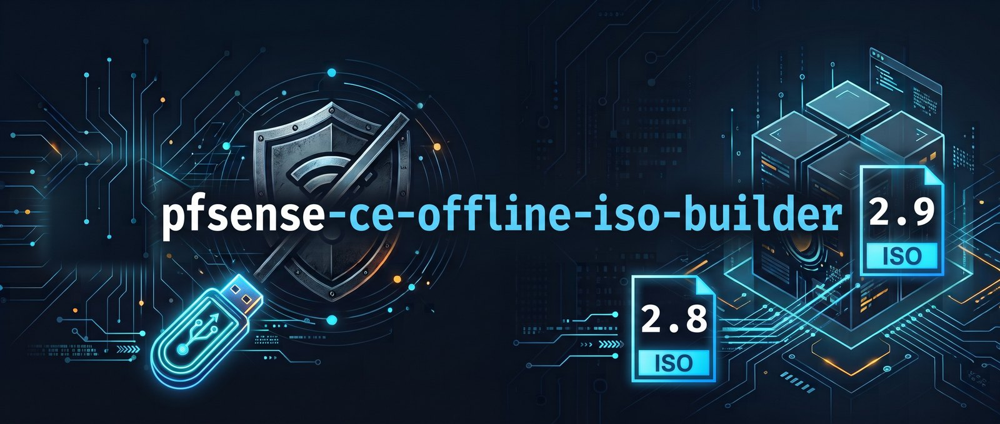
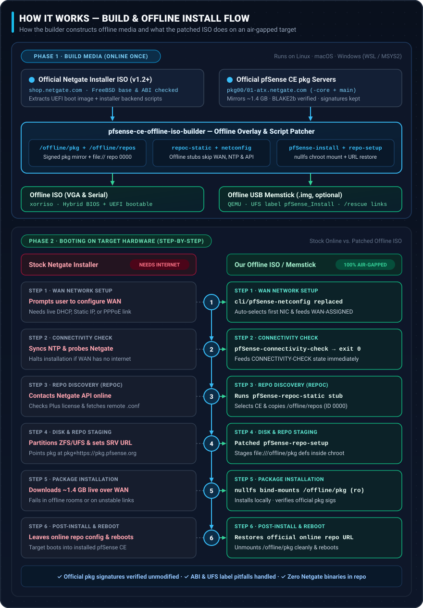

<p align="center">
  
</p>

# pfsense-ce-offline-iso-builder

<p align="center">
  
  
  
  
  
</p>

> [!NOTE]
> **pfSense CE 2.9.2 Verified:** Tested and confirmed working with the newly released **pfSense CE 2.9.2** — fully offline installation completes smoothly on both **UEFI** and **Legacy BIOS / MBR** systems.
Builds **fully offline** installation media for pfSense CE.

Starting with 2.8.0, Netgate only ships the **Netgate Installer** for CE: a
small network installer that downloads packages during installation. Full ISO
images stopped at 2.7.2. This tool takes the official installer image *you*
download, embeds a mirror of the official pkg repository into it, and produces
media that installs without any network access — similar in spirit to what
UUP dump does for Windows.

**This repository contains no Netgate/pfSense binaries, logos or trademarks.**
You supply the installer image; packages are fetched from Netgate's public pkg
servers; the resulting image is built on your machine and stays there.

## The only thing you need

The **Netgate Installer ISO** —
<https://shop.netgate.com/products/netgate-installer> (free, requires a Netgate
account). It must be **v1.2-RELEASE or newer**; the script checks the version
and stops early if it is incompatible.

If you omit `-i`, the script looks for the ISO itself: it picks the newest
`netgate-installer*.iso` in the current directory, the script directory and
your download folders. If none is found, it **opens the download page in your
browser** and tells you where to put the file. Without a desktop session (SSH,
headless server) it only prints the URL.

All other dependencies (`curl`, `python3`, `xorriso`, `7z`, `qemu`) are
**installed automatically**. Supported package managers: apt, dnf, yum, pacman,
zypper, apk, Homebrew, MacPorts and MSYS2. On macOS it offers to install
Homebrew if it is missing. Use `--no-install` to disable this and install
dependencies yourself.

Before starting, it **checks free disk space** and stops with suggestions if
there is not enough. When finished, it asks whether to delete the mirror cache
(`--keep-cache` / `--clean-cache` decide without asking).

## Usage

### Linux / macOS

```bash
# list CE versions available on the server
./pfsense-ce-offline-iso-builder.sh --list

# VGA + serial console ISOs for 2.9.0
./pfsense-ce-offline-iso-builder.sh -i netgate-installer-v1.2-RELEASE-amd64.iso -c both 2.9.0

# ISOs + USB images for 2.9.0 and 2.8.1
./pfsense-ce-offline-iso-builder.sh -i netgate-installer-v1.2-RELEASE-amd64.iso \
    -c both --memstick 2.9.0 2.8.1
```

Works the same on Apple Silicon and Intel Macs (the produced images are always
amd64). You can either clone the repository or download just
`pfsense-ce-offline-iso-builder.sh` (or `.ps1` on Windows) — any missing files
under `lib/` are fetched automatically on the first run.

### Windows

Building the ISO requires `xorriso`, which has no native Windows build. The
PowerShell entry point therefore finds a POSIX environment (WSL or MSYS2),
installs one if needed, translates paths and runs the real builder there:

```powershell
# list versions
.\pfsense-ce-offline-iso-builder.ps1 -ListVersions

# VGA + serial console ISOs for 2.9.0
.\pfsense-ce-offline-iso-builder.ps1 -Installer .\netgate-installer-v1.2-RELEASE-amd64.iso `
    -Version 2.9.0 -Console both

# several versions + USB images
.\pfsense-ce-offline-iso-builder.ps1 -Installer .\netgate-installer-v1.2-RELEASE-amd64.iso `
    -Version 2.9.0,2.8.1 -Console both -Memstick
```

If neither WSL nor MSYS2 is present, it asks which one to install. Force one
with `-Backend wsl` or `-Backend msys2`. WSL is recommended; since `--memstick`
needs qemu, USB image creation only works reliably under WSL.

Installing WSL requires administrator rights and a reboot:

```powershell
wsl --install -d Ubuntu
```

Output goes to `out/`; the mirror is kept in `mirror/` and reused on later runs.

| Option | Description |
|---|---|
| `-i, --installer` | Netgate Installer ISO (`.gz` also accepted) |
| `-o, --out` | Output directory (default `./out`) |
| `-M, --mirror` | Package mirror directory (default `./mirror`) |
| `-c, --console` | `vga` \| `serial` \| `both` |
| `--memstick` | Also build a USB image (requires qemu) |
| `-j, --jobs` | Parallel downloads |
| `--keep-cache` / `--clean-cache` | Keep / delete the mirror without asking |
| `--no-install` | Do not install dependencies automatically |
| `--skip-space-check` | Skip the disk space check |
| `--list` | List versions available on the server |

Writing to a USB stick:

```bash
sudo dd if=out/pfSense-CE-offline-memstick-2.9.0-amd64.img of=/dev/sdX \
    bs=4M status=progress conv=fsync
```

On Windows use Rufus (DD mode) or balenaEtcher.

## ⚠️ Licensing — why we ship the script, not the images

*Not legal advice; a summary based on the cited sources.*

**The source code is fine.** pfSense CE is released under the
[Apache License 2.0](https://github.com/pfsense/pfsense), which permits
modification and redistribution. But Apache 2.0 **§6 explicitly grants no
trademark rights** — and that is where the problem lies.

**The trademark policy rules out distributing built images.** From the
[pfSense Trademark Usage Guidelines](https://www.pfsense.org/trademarks.html):

- Allowed: *"non-commercial redistribution of **bit-for-bit identical copies**
  of official pfSense releases"*.
- Not allowed: *"Using the pfSense Marks in connection with **any rebuild** of
  pfSense software, unless such rebuild is an official pfSense build"*, and
  *"You may not ... state that such modified software is pfSense."*

An image produced by this tool is by definition an unofficial rebuild: the
installer scripts are modified and a package mirror is embedded.

**The image also carries Netgate's own content.** The installer binaries
(`pfSense-installer`, `pfSense-repoc`), boot logo and branding belong to
Netgate, and the image's own notice says:

> "All logos, text, and content of ESF and/or Netgate ... may not be used or
> reproduced without the prior express written permission of ESF and/or Netgate."

So **publicly distributing** a built image raises two separate issues:
unauthorized trademark use, and redistribution of Netgate's non-open content.
(The embedded mirror also contains hundreds of third-party packages with their
own license obligations, e.g. source offers for GPL software.)

**Distributing the script is different.** This repository contains only our own
code: no Netgate binaries, no logos, no packages, no use of the marks. Users
download the installer from Netgate themselves, fetch packages from Netgate's
servers themselves and build the image on their own machine. Building an image
for your own use is legitimate — Apache 2.0 allows modification, and the
trademark policy restricts *distribution*, not use.

| Action | Status |
|---|---|
| Building and using an image yourself | Fine |
| Installing on your own organization's devices | Fine in practice |
| Sharing this script | Fine |
| Publicly distributing built images | **Not recommended** — trademark + copyright |
| Selling / commercially distributing images | **No** |

## Known behavior

During installation the target's pkg repository is switched to the official
URL, but pfSense regenerates this file from its own configuration on first boot
and the media's `file:///offline/pkg/...` address comes back. This does not
affect installation or operation; once the box has internet access, refresh the
repository definitions once so packages can be installed:

```sh
pfSense-repoc
```

For installations that stay offline this is irrelevant.

## How it works

<p align="center">
  
</p>

Online repositories use `pkg+https://pkg.pfsense.org/...` with `mirror_type: srv`; the
actual servers are resolved from DNS SRV records (`pkg00-atx.netgate.com`,
`pkg01-atx.netgate.com`).

Changes made to the media:

1. `/offline/pkg/` — a full mirror of the version's `-core` and main
   repositories. Signed metadata is copied verbatim, so pkg's signature
   verification remains valid.
2. `/offline/repos/` — the repo definitions repoc would write, pointing to
   `file://` URLs.
3. `pfSense-repoc-static` → a shell replacement that copies those definitions
   into place instead of contacting Netgate.
4. `backend/pfSense-connectivity-check` → `exit 0`.
5. `cli/pfSense-netconfig` → no network configuration; the `WAN-ASSIGNED` and
   `CONNECTIVITY-CHECK` states the installer daemon expects are fed directly.
6. `backend/pfSense-install` → the mirror is bind-mounted (`nullfs`) into the
   chroot (pkg runs inside the chroot, so `file://` resolves relative to it).

The full repository is always mirrored (~1.3–1.5 GB per version). pkg pulls in
packages beyond the declared dependency closure, so a partial mirror leaves the
installation incomplete.

### Three pitfalls this tool handles

**ABI compatibility.** 2.9.0 packages are `FreeBSD:16:amd64`, 2.8.x packages
are `FreeBSD:15:amd64`. If the installer base is **older** than the packages,
installation crashes with a segmentation fault at `pfSense-system` (this is not
specific to offline media — online installs fail the same way). The script
checks this up front.

**Single-repo media.** When there is exactly one repository,
`cli/pfSense-repo-setup` sends the repo's `.name` to the daemon, but the daemon
looks up the conf file by **ID**. Netgate's server always returns ≥2
repositories, so this path never runs in practice. The tool sets the `.name`
contents equal to the ID (`0000`).

**Memstick root label.** `pfSense-installer` calls `statfs("/")` at startup and
validates the root device's GEOM label; on an unknown label it silently
`exit(1)`s. Since nginx stays up, the symptom is misleading ("Cannot connect to
installer daemon"). Netgate's memstick uses the `pfSense_Install` label; so
does this tool.

Also, ISO9660 does not preserve hard links: the ~148 entries under `/rescue`
are links to a single ~20 MB crunched binary and take 2.7 GB when copied
naively. `mk-memstick.sh` excludes that directory and recreates it as hard
links.

## Files

| File | Purpose |
|---|---|
| `pfsense-ce-offline-iso-builder.sh` | Main entry point (Linux/macOS/MSYS2) |
| `pfsense-ce-offline-iso-builder.ps1` | Windows entry point; finds WSL/MSYS2, translates paths |
| `lib/deps.sh` | Dependency detection and automatic installation |
| `lib/space.sh` | Disk space estimation and check |
| `lib/mirror-repo.py` | Mirrors the pkg repository, verifies checksums |
| `lib/pkgsum.py` | pkg checksum format (BLAKE2b-512 + z-base-32, LSB-first) |
| `lib/patch-install.py` | Patch for `backend/pfSense-install` |
| `lib/patch-reposetup.py` | Patch for `backend/pfSense-repo-setup` |
| `lib/build-memstick.sh` | Drives USB image creation with QEMU |
| `lib/mk-memstick.sh` | Runs inside the VM; creates UFS, writes boot code |
| `lib/patch-serial.sh` | Converts a finished memstick to serial console |
| `lib/vmshot.py` | QEMU monitor driver |

## License

The scripts in this repository are MIT licensed (`LICENSE`). The contents of
the images they produce belong to Netgate/ESF, the FreeBSD Project and the
respective third-party package authors, and are subject to their own licenses.

pfSense® is a registered trademark of Electric Sheep Fencing LLC, exclusively
licensed to Netgate. This project is not affiliated with or endorsed by Netgate
or ESF.
